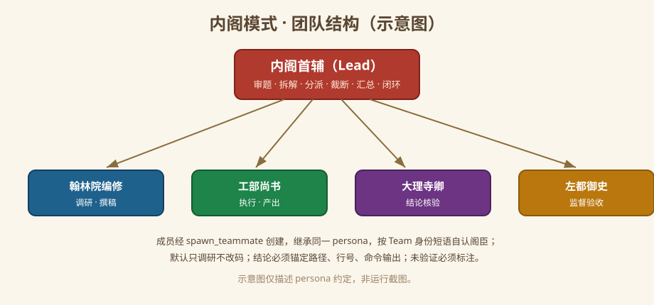

# Cabinet Mode (内阁模式) for DeepSeek Harness

[中文](README.zh.md) | English

<p align="center">
  
</p>
<p align="center"><sub>Icon: Ming-dynasty grand-secretary portrait provided by the project owner (shipped as <code>icon.svg</code>).</sub></p>

A small **DSH bundle** that adds **Cabinet Mode** (`内阁模式`) to
[DeepSeek Harness](https://github.com/deepseek-ai/deepseek-harness). Install the
bundle, restart DSH, and pick **内阁模式** when starting a new session. The mode is
a research-team preset modeled on the Great Ming Research Bureau cabinet
(大明科研司·内阁): a Lead (内阁首辅) directs members (阁臣) of four bureaus, defaults
to research before touching code, and must never fabricate sources.

The package ships a host half (`index.js`, an empty `apply`) and a browser half
(`client.js`, the right-Sidebar **Cabinet** panel) with the five member avatars
embedded as 128px data URLs (square sources in `docs/images/avatars/`,
downscaled by `src/build_avatars.py`); it also keeps the optional Node.js
fallback scripts (`scripts/*.mjs`). It has **no third-party runtime
dependencies** — React and friends come from the DSH client module table, with no
bundled duplicate and no CDN.

It declares **two rows** — `preset-cabinet` (one `@deepseek-ai/dsh-agent-preset`
declaration) and `cabinet-ui` (the Loader row that loads this package's
JavaScript) — and reuses the plugin list shipped with DSH **Standard Mode**, so
the mode has the same tools as Standard Mode; what differs is the persona, plus
the right-Sidebar **Cabinet** panel. Team tools (`spawn_teammate`, `team_task_*`,
and the rest) come from the profile-level
`@deepseek-ai/dsh-experimental-agent-team-profile` bundle; **this preset does not
ship them**.

This bundle declares **no hard DSH version gate**: no `engines.dsh`, no DSH
`peerDependencies`, no install-time version check. It was tested on DSH
**0.2.1-rc.3**; other DSH versions that provide the declarative preset mechanism
may work, but are **not verified** (see [DSH-side constraints](#dsh-side-constraints)).

## The cabinet at a glance



### Screenshots

Real runtime captures (mode picker, Agent-preset card, a cabinet session) are
welcome — open a PR or send them to us and we will include them here. The image
above is a layout diagram of the persona, not a screenshot.

## Cabinet panel and member avatars

A new right-Sidebar **「Cabinet」** tab, registered by this package's browser half
(`client.js`) through its second Loader row `cabinet-ui`, independent of the
preset declaration:

- **Dispatch tree** — the Lead sits on top; every task hangs under the member
  named by its `ownerName`, with `blockedBy` dependencies shown as chips beneath
  the task: who was assigned what, and what blocks it, at a glance.
- **Who is working** — a running member's row is tinted green and its status dot
  pulses; idle / starting / failed use gray / amber / red dots, and the Lead's
  row highlights the same way.
- **Task colours** — pending gray, in progress blue, completed green (legend at
  the bottom of the panel).
- **Member look** — each row carries a circular avatar (22px, 24px for the Lead),
  the Chinese role and original member name, a status label and the current model.
  Aliases share a bureau avatar, while original names keep members distinguishable
  in cards, Owner tags and off-roster groups. Truncated labels have full tooltips;
  unmatched names use a neutral avatar.

The five member avatars are tinted per bureau: Lead bright yellow, 翰林院编修
(编辑) cyan, 工部主事 (执行) red, 大理寺评事 (核验) dark, 都察院御史 (验收)
crimson — light-toned chibi portraits in Ming-style court dress
(soft-focus guofeng backdrop inside the circle). They are
embedded in `client.js` as 128px data URLs; the square source PNGs live in
`docs/images/avatars/` and are downscaled by `src/build_avatars.py` (originals
are kept at 512x512 and are never embedded directly).

Example (the other four are in the same directory: `hanlin.png` / `works.png` /
`dali.png` / `yushi.png`):


The panel reads two existing data channels only — per-session running status
(`api-session/status`) and the `agentTeam` session projection (roster and task
board). It adds no service and no protocol.

## How it takes effect

- **Fully quit and restart DSH after installing or updating**: the preset
  declaration and the client plugin are only assembled at startup, so nothing
  takes effect before the restart.
- After the restart, start a **new session** and pick **内阁模式** (`cabinet`) in
  the mode picker.
- Opening the right-Sidebar **Cabinet** tab: the **+** on the tab strip, then the
  **Cabinet** entry on the guide page.
- The panel renders in the **browser** (`client.js`): exercise it in a real
  session after a restart; this repository ships no browser screenshot yet.

---

## Install with an AI agent (copy this prompt)

```text
Install the "Cabinet Mode" (内阁模式) DSH bundle for me.

1. Run `dsh --version` and tell me the version. 0.2.1-rc.3 is the tested reference;
   this bundle declares no hard DSH version gate, but other DSH versions are not verified.
2. Install the bundle into my DSH profile:
   dsh plugin --profile desktop add <absolute path to the dsh-cabinet-mode checkout or .tgz>
   (You can also use the GitHub Release tarball URL instead of a local path.)
   If the `dsh` CLI is unavailable, open DSH Settings -> Plugins -> Add plugin and
   choose "local directory" with the absolute path of the dsh-cabinet-mode checkout.
3. Run `dsh plugin --profile desktop list` and confirm `dsh-cabinet-mode` is installed.
4. Do NOT also append cordis.patch.yml to my profile patch: the two installation
   methods are mutually exclusive and duplicate preset ids fail to load.
5. Tell me to fully quit and restart DSH, then create a new session and choose
   "内阁模式" (preset id: cabinet) in the mode picker.

If any step fails, show the exact error and stop. Do not retry more than once.
```

## Manual install (3 lines)

```sh
dsh plugin --profile desktop add https://github.com/luodaoyi/dsh-cabinet-mode/releases/download/v0.2.0/dsh-cabinet-mode-0.2.0.tgz
# fully quit and restart DeepSeek Harness
# New session -> mode picker -> 内阁模式
```

For a local checkout, replace the tarball URL with the absolute path of this
repository. On Windows the CLI is `dsh` (runs through `dsh.cmd`); the same
commands work on Linux and macOS.

> **DSH 0.2.1-rc.5 desktop notes (tested 2026-10-31):**
>
> - The `dsh` CLI that ships with the desktop app runs `dsh plugin --profile
>   desktop list/add ...` fine (exit 0). On first use it may ask you to initialize
>   the profile ("Open DeepSeek Harness Desktop once … then fully quit it") and may
>   wait up to 120 s on a profile lock — so **fully quit DeepSeek Harness before
>   installing or upgrading**.
> - What a desktop profile does reject is `dsh --profile desktop --dump-config`
>   ("managed exclusively by the Electron application"); run composition checks
>   against the `web` profile instead.
> - Fallbacks: the plugin page (Settings → Plugins → Add plugin → local directory /
>   tarball URL), or the pnpm shipped inside DeepSeek Harness (keeps
>   `dsh-cabinet-mode` in `dsh.profile.bundles`):
>
> ```sh
> node "<DeepSeek Harness install>\resources\runtime\primary-runtime\dependencies\pnpm\bin\pnpm.mjs" --dir "%USERPROFILE%\.dsh\profiles\desktop" add https://github.com/luodaoyi/dsh-cabinet-mode/releases/download/v0.2.0/dsh-cabinet-mode-0.2.0.tgz
> ```
>
> Back up the profile's `package.json` / `pnpm-lock.yaml` first.

## Install from the plugin market

The bundle is also listed in a DeepSeek Harness plugin market index that is
generated from the npm registry, so DSH can install and update it without a tarball
URL or a local checkout:

```text
https://raw.githubusercontent.com/luodaoyi/dsh-cabinet-mode/market-index/marketplace.json
```

1. Open **Plugin market** (插件市场) in DSH, open **Index sources** (索引源), add the
   URL above, and refresh it.
2. Install **内阁模式 / Cabinet Mode** (`dsh-cabinet-mode`) from the market list that
   appears. DSH installs `dsh-cabinet-mode@<version>` from
   `https://registry.npmjs.org` into the current profile. This is the same bundle
   install as Method A below — use one of them, never both.
3. **Fully quit and restart DeepSeek Harness**, then create a new session and pick
   **内阁模式** in the mode picker.
4. To update later: on the **Installed** (已安装) page, uninstall the old version
   first, then install the newer version from **Plugin market**, and restart again.
   The market has **no in-place update** for third-party plugins — the "update
   available" (有新版本) badge only opens the Installed page.

How "update available" is detected: DSH compares **SemVer versions only**, so a
package rebuilt under the same version number is not flagged (npm versions are
immutable, so this does not affect the npm source). There is **no periodic
auto-check**: the index is fetched when the plugin market is opened or refreshed
and cached for 10 minutes. These are code-level findings from the DSH 0.2.1-rc.5
sources, recorded with line references in [docs/cross-platform.md](docs/cross-platform.md) (§7);
the real update flow was not exercised end to end.

The index is regenerated from the npm registry after every tagged release and only
lists published, non-deprecated stable versions; do not edit the `market-index`
branch by hand.

> **Release status (2026-11-03):** `dsh-cabinet-mode@0.1.4`, `0.1.5` and `0.1.6` are
> published on `registry.npmjs.org` by the tag-triggered OIDC workflow, each with a
> provenance attestation on sigstore, and the `market-index` branch is refreshed
> automatically after every publish. The whole tag → publish → GitHub Release → index
> refresh chain has run green twice (v0.1.5: run 41657224370, v0.1.6: run
> 41661809576), and the index now lists 0.1.6, 0.1.5 and 0.1.4. The registry also
> carries a placeholder `0.0.0-stage` prerelease, which the index intentionally does
> not list.
>
> **Not verified:** the exact plugin-market UI labels and click path in your DSH
> build, and a real install/update in that GUI. The
> `dsh-cabinet-mode@<version>` install spec is what the format-1 reader
> (`@deepseek-ai/dsh-plugin-market-index@0.2.1-rc.5`, `marketInstallTarget`) returns
> for an npm source; that function was executed locally, the UI was not.

## Upgrade

Installed through the plugin market? Refresh the market, uninstall the old version
on the **Installed** page, install the newer version from **Plugin market**, and
restart — there is no tarball URL to change and no one-click update. Otherwise run
the same install command with the new version URL (or pick the new `.tgz` in the
plugin page), then fully quit and restart DeepSeek Harness:

```sh
dsh plugin --profile desktop add https://github.com/luodaoyi/dsh-cabinet-mode/releases/download/v0.2.0/dsh-cabinet-mode-0.2.0.tgz
```

`dsh plugin --profile desktop list` should report the new version. Upgrades were
performed and verified on Windows: v0.1.0 → v0.1.1 via the plugin CLI on DSH
0.2.1-rc.3, then v0.1.1 → v0.1.2 and v0.1.2 → v0.1.3 via the embedded-pnpm route
on DSH 0.2.1-rc.5.

---

## What you get

| | |
|---|---|
| Mode name | 内阁模式 (**Cabinet Mode**), preset id `cabinet`, order 5 |
| Identity | One persona shared by the Lead and every teammate. The Lead (内阁首辅) reads the request, splits it, assigns work, adjudicates, summarizes and closes the loop; members (翰林院编修 / 工部主事 / 大理寺评事 / 都察院御史) execute bureau-scoped work and must never claim to be the Lead. |
| Default posture | Research first, change code only when explicitly authorized; every conclusion must cite a path, line, command output or source; unverified items must be marked as such. |
| Tools | Same 22 plugin rows as the tested DSH Standard Mode (shell, filesystem, jobs, schedule, skills, goals, plan mode, compaction, delegation/workflow, ask-user, todo, web, present). |
| Platform | Cross-platform: `tool-bash` is enabled on Linux/macOS, `tool-pwsh` on Windows, exactly like Standard Mode. No absolute paths, no shell-specific install step, no build step. |
| Team tools | The nine Agent Team tools come from the `@deepseek-ai/dsh-experimental-agent-team-profile` profile bundle, not from this preset. If that bundle is not enabled in your DSH profile, the cabinet runs without teammate tools. |

## Requirements

- **DeepSeek Harness with declarative agent presets.** The preset declaration is a
  0.2.1-rc.3 composition reference. **Real installs and upgrades were tested on a
  Windows desktop with DSH 0.2.1-rc.3 and 0.2.1-rc.5** (local directory, GitHub
  Release asset URL, embedded-pnpm route; 2026-10-29 and 2026-10-31). The bundle
  declares **no DSH version dependency and no hard DSH version gate**
  (`engines.dsh` / DSH `peerDependencies` are absent), so other DSH versions that
  ship the declarative preset mechanism can try it — but they are **not verified**.
  Still untested: the post-restart UI (mode picker / preset card / icon display)
  and non-Windows hosts.
- Other DSH versions may ship a different built-in Standard Mode plugin set. If a
  declaration fails to load on your version, adapt the plugin rows to your version's
  shipped `presets/standard.patch.yml` (see
  [DSH-side constraints](#dsh-side-constraints)); keep the `persona` row and its
  config intact.
- Node.js **>= 20 only for the optional fallback scripts** (`scripts/*.mjs`).
  The recommended plugin install path does not use Node directly.
- Optional: enable **Agent Teams** for the full Lead/teammate workflow.

## Installation matrix

| Method | Windows | Linux | macOS | Notes |
|---|---|---|---|---|
| **A. DSH plugin manager** (recommended): plugin page "Add plugin -> local directory/package", or `dsh plugin --profile <profile> add <absolute path / .tgz / release URL>` | ✅ tested locally on 2026-10-29: local-directory install **and GitHub Release asset URL install**; `dsh plugin --profile desktop list` = 3 packages; composition check passed | ⚙️ code-level inference, **not tested on this machine** | ⚙️ code-level inference, **not tested on this machine** | Pure YAML bundle: no build, no dependencies, no OS-specific code. See [docs/cross-platform.md](docs/cross-platform.md). |
| **B. Fallback node scripts** (no plugin manager): `node scripts/install.mjs --profile <profile>` then `--apply`; writes the profile `cordis.patch.yml` | ✅ scripts tested on Windows (dry-run + temp copies) | ⚙️ code-level inference, **not tested** | ⚙️ code-level inference, **not tested** | Same file layout on all platforms: `<DSH_HOME>/profiles/<profile>/cordis.patch.yml`. |
| **Plugin market** (index source): see [Install from the plugin market](#install-from-the-plugin-market) | ❌ **GUI install not tested** (npm publish + index are live as of 2026-11-03) | ❌ **not tested** | ❌ **not tested** | Same npm bundle install through DSH's plugin market; the npm publish and the `market-index` branch now exist. |

**Method A and Method B are mutually exclusive.** Both create the preset
declaration `config.id: cabinet`. Installing both makes the preset id appear
twice, and the preset declaration then fails to load. Uninstall one method before
switching to the other. The plugin-market route installs the same bundle as
Method A, so the same exclusivity applies to it.

### A. Install as a DSH bundle (recommended, all platforms)

1. Install the bundle into the profile you use:
   - **Plugin page:** Settings → Plugins → Add plugin → local directory / package,
     then select this repository (or its `.tgz`).
   - **CLI:** `dsh plugin --profile desktop add <absolute path to this repo, .tgz, or release URL>`
2. Confirm: `dsh plugin --profile desktop list` shows `dsh-cabinet-mode`.
3. Fully quit and restart DeepSeek Harness.
4. Create a new session and pick **内阁模式** in the mode picker.

Both a local-directory install and a GitHub Release asset URL install were tested
on Windows with DSH 0.2.1-rc.3 (2026-10-29); the URL install completed in about
2.4 s and `dsh plugin --profile desktop list` reported 3 packages.

### B. Fallback: write the profile patch layer (no plugin manager)

This installs the persona preset only. The Cabinet panel and member avatars require
Method A, which installs the runtime package into the profile.

Requires Node.js >= 20. The scripts are cross-platform and dry-run by default.

```sh
node scripts/install.mjs --profile desktop          # dry run: prints the plan only
node scripts/install.mjs --profile desktop --apply  # backs up, writes, self-checks
node scripts/verify.mjs                             # repository + dsh composition check
# fully quit and restart DeepSeek Harness
```

The script writes `<DSH_HOME>/profiles/<profile>/cordis.patch.yml` (default
`%USERPROFILE%\.dsh` on Windows, `~/.dsh` on Linux/macOS). It refuses when the
bundle is already installed in the profile, refuses when `preset-cabinet` already
exists, keeps a unique timestamped backup (`YYYYMMDD-HHMMSS` + random suffix),
verifies the backup SHA-256, wraps the insert in `BEGIN/END` markers, replaces the
whole file when the target is empty/`[]`/comments-only (appending in that case
would produce invalid YAML), and restores the backup if the post-write check fails.

## Enable and verify

- **Restart is required.** Preset declarations load eagerly; changes only affect
  sessions created afterwards.
- New session → mode picker → **内阁模式** (`cabinet`). The mode is fixed for the
  session once it has produced any output.
- Check the mode is present: Settings → Agent presets should show the
  **内阁模式** card; its configuration view is read-only.
- Repository check: `node scripts/verify.mjs` — it asserts the package fields,
  absence of a DSH version gate, the preset declaration, the 22-row plugin list,
  the dual-identity persona, cross-platform guards, README/docs consistency, and
  (when `dsh` is on PATH) runs
  `dsh --profile web --patch ./cordis.patch.yml --dump-config`, expecting exit 0
  with exactly one `preset-cabinet` and the four shipped presets intact. The DSH
  version is reported informationally only and never fails the run.

## DSH-side constraints

The mode is a DSH preset; DSH itself still imposes its own limits. The facts below
were verified on this machine's DSH 0.2.1-rc.3; they describe DSH behavior, not
restrictions added by this bundle.

- **No hard DSH version limit.** This package declares no `engines.dsh` and no DSH
  `peerDependencies` (a product decision recorded in CHANGELOG 0.1.1), and does no
  version check at install time. Tested on DSH
  0.2.1-rc.3 (composition reference) and 0.2.1-rc.5 (real install + upgrade,
  Windows desktop, 2026-10-31); other versions remain **unverified**. The 22
  plugin rows are copied from the 0.2.1-rc.3 shipped Standard Mode and matched the
  rc.5 shipped Standard Mode row-for-row. If your DSH version ships a different
  built-in plugin set (more or fewer rows) and the declaration fails to load,
  adapt `cordis.patch.yml` to your version's shipped `presets/standard.patch.yml`:
  keep the `persona` row (and its config) and add/remove tool rows so the list
  matches your DSH version.
- **Agent Team limits** come from the `@deepseek-ai/dsh-experimental-agent-team-profile`
  bundle enabled in the DSH profile (verified defaults in the desktop profile's
  configuration): `maxMembers: 8`, `maxTasks: 256`, `maxMessageBytes: 65536`,
  `disposalTimeoutMs: 5000`. The deployment default is `maxMembers: 16`; this
  desktop profile sets 8. `maxMembers` includes teammates that failed; a single
  Team message is at most 64 KiB.
- **Team tools require that profile bundle.** The nine Agent Team tools
  (`spawn_teammate`, `send_message`, `list_agents`, `interrupt_agent`,
  `wait_agent`, `team_task_*`, …) exist only when the profile includes
  `@deepseek-ai/dsh-experimental-agent-team-profile`. Without it the cabinet mode
  has no team tools; the persona rules still apply, with no Lead/teammate split
  achievable.
- **Permissions and sandboxing belong to DSH.** The sandbox and approval behavior
  is decided by the DSH permission preset (on this machine the desktop profile's
  user layer is set to `danger-full-access`). This mode adds **no** sandbox
  restrictions of its own and does not widen the DSH policy either.
- **A preset is trusted configuration.** Its plugins can execute host code; only
  install presets from sources you trust.
- **No OS restriction, no plugin allowlist, no npm account.** The bundle is
  platform-neutral YAML and is distributed as a GitHub Release tarball and a public
  npm package; installing either way needs no npm account and no plugin allowlist
  entry.
- **Restart, session lock, Web read-only.** Install and uninstall require a DSH
  restart; after a session has produced output its mode is locked for the session
  lifetime; in the Web UI the mode can be selected and its configuration viewed
  read-only, not edited.

## Rollback

| Installed with | Remove with | Then |
|---|---|---|
| Method A (bundle) | `dsh plugin --profile desktop remove dsh-cabinet-mode` | Fully restart DSH |
| Method B (node script) | `node scripts/uninstall.mjs --profile desktop --apply` | Fully restart DSH |

The fallback uninstaller only removes its own `BEGIN/END` block. It refuses to
touch a `preset-cabinet` entry it did not write (bundle or manual install); remove
that through the plugin page instead. Both commands are dry-run by default; add
`--apply` to write.

## Releasing (maintainers)

Pushing a version tag runs `.github/workflows/release.yml`, which verifies the tree,
packs the tarball, publishes it to npm with **Trusted Publishing (OIDC)** — no
long-lived npm token — creates the GitHub Release, and then refreshes the
`market-index` branch that the plugin market reads.

```sh
# package.json version and the matching CHANGELOG section must both be 0.2.0
git tag v0.2.0
git push origin v0.2.0
```

One-time setup on npmjs.com (a maintainer action; it cannot be done from this
repository). Add a GitHub Actions trusted publisher for the package with:

- Organization or user: `luodaoyi`
- Repository: `dsh-cabinet-mode`
- Workflow filename: `release.yml` (file name only, including the extension; the
  file must stay at `.github/workflows/release.yml` and keep the publish step)
- Environment name: leave empty unless the publish job later gets a GitHub
  environment
- **Allowed actions: select `npm publish`.** Trusted publishers created after
  2026-09-03 default to `npm stage publish` only, and a plain `npm publish` is
  rejected unless it is explicitly allowed.

A newly created trusted-publisher configuration must complete its first successful
publish within **2 days**, otherwise it expires and must be deleted and recreated.
`repository.url` in `package.json` must exactly match the GitHub repository, which
it does (`git+https://github.com/luodaoyi/dsh-cabinet-mode.git`).

**The first version needs a one-time bootstrap.** npm refuses to configure a trusted
publisher for a package that does not exist yet (`npm trust` requires "Package must
exist"; npm/cli#8544 is still open). `dsh-cabinet-mode` was bootstrapped on
2026-11-03 with `npm stage publish` (npm >= 11.15.0): it published the public
placeholder version `0.0.0-stage` and left the real version staged for approval. The
placeholder is a prerelease, so the market index never lists it. Later versions need
no bootstrap: push a tag and the workflow publishes with OIDC.

These npm-side facts come from the npm documentation page "Trusted publishing for
npm packages" (https://docs.npmjs.com/trusted-publishers); the current npmjs.com
page layout was **not verified** from this repository. Trusted publishing requires
npm CLI >= 11.5.1 and Node >= 22.14.0 — the workflow runs Node 24. `npm whoami` does
not check trusted-publishing permissions (the npm documentation says so), so the
workflow does not use it as a pre-flight check.

If the npm publish succeeds but the index job fails, run the **Market index**
workflow manually to refresh the branch.

The branch publisher is `scripts/publish-market-index.sh` (also wired to
`npm run market:publish`); it needs `bash`, which ships with Git for Windows. It
checks out an orphan branch and rewrites the working tree, so run it **only in a
disposable clone with no uncommitted work** — it refuses when a tracked file is
modified or staged, but untracked files are not protected.

## Unverified items

These were **not** tested on this machine and must not be presented as verified:

- **Multi-version compatibility.** Tested on DSH 0.2.1-rc.3 (composition check,
  plugin-page/CLI install) and 0.2.1-rc.5 (real install + upgrade, Windows
  desktop, 2026-10-31). Other DSH versions and upgrade paths remain unverified.
- **Post-restart UI and icon display.** The mode picker, the Agent-preset card
  and the bundle icon have not been verified after a restart on any machine yet.
- Real bundle installation and the post-restart mode picker on **Linux and macOS**
  (code-level inference only; Windows was tested locally, including the Release
  asset URL install).
- Live teammate behavior: whether a spawned teammate inherits this persona and
  actually follows the member identity instead of claiming to be the Lead.
- Whether the installed bundle or the fallback patch survives DSH app upgrades.
- Whether `config.id` syntax rules reject unusual ids (this id is `cabinet`).
- HMR behavior for preset declarations, and private-registry/proxied tarball
  installs.
- **The plugin market in real use.** Parsing the published index, resolving the npm
  install spec and installing `dsh-cabinet-mode@0.1.5` into a throwaway profile were
  exercised locally, and the full tag → publish → automatic index refresh chain runs
  in CI (v0.1.5, run 41657224370), but no install or update has been performed in
  the DSH plugin-market GUI itself.

## Known limitations

- A preset is **not a sandbox**: declarations are trusted configuration and can
  execute host code. Review bundles before installing them.
- A user override of this preset replaces the whole plugin list; it does not merge
  future upstream changes.
- Other DSH versions may ship a different Standard Mode plugin set; the 22 rows
  here are the 0.2.1-rc.3 reference and may need adaptation (see
  [DSH-side constraints](#dsh-side-constraints)).
- The persona is shared by the Lead and every teammate, so it must decide identity
  from the Agent Team runtime context (exact phrases
  `You are the Team Lead named "lead".`,
  `You are teammate "<name>".`, `Your Team Lead is named "lead".`); teammates are
  forbidden from claiming to be the Lead.
- The persona must not contain `{{cwd}}` or other unregistered prompt variables;
  DSH 0.2.1-rc.3 fails prompt assembly before the first model request.
- Team workflow depends on the Agent Teams profile bundle being enabled.

## Cross-platform notes

See [docs/cross-platform.md](docs/cross-platform.md) for the code-level analysis
of the install chain, the `!!js process.platform` guards, the fallback patch path,
and the Windows-tested vs Linux/macOS-inferred split. Sections:

- [Conclusion matrix (结论矩阵)](docs/cross-platform.md#结论矩阵) — platform × 13 items, with a tested-vs-inferred column
- [Item-by-item analysis (逐项论证)](docs/cross-platform.md#逐项论证)
- [Not tested on this machine (未在本机实测清单)](docs/cross-platform.md#未在本机实测清单)
- [Evidence index (依据索引)](docs/cross-platform.md#依据索引)

## License

[MIT](LICENSE)
