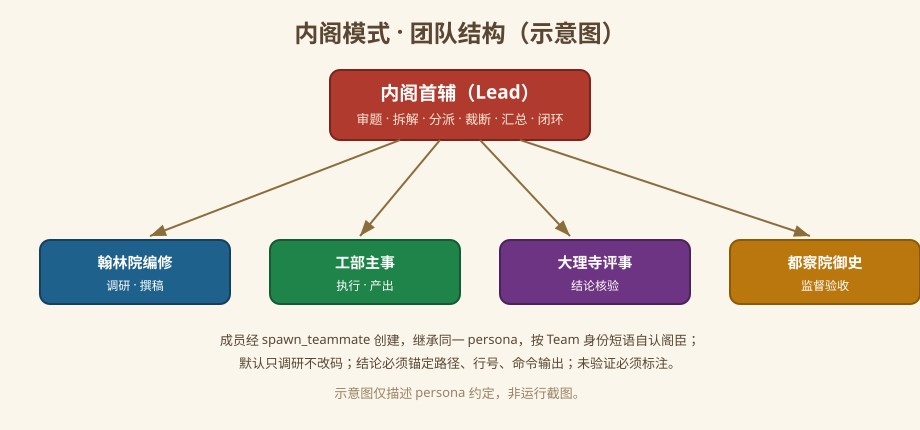

# Cabinet Mode (内阁模式) for DeepSeek Harness

[中文](README.zh.md) | English

<p align="center">
  
</p>
<p align="center"><sub>Icon: Ming-dynasty grand-secretary portrait provided by the project owner (shipped as <code>icon.svg</code>).</sub></p>

A small **declarative DSH bundle** that adds **Cabinet Mode** (`内阁模式`) to
[DeepSeek Harness](https://github.com/deepseek-ai/deepseek-harness). Install the
bundle, restart DSH, and pick **内阁模式** when starting a new session. The mode is
a research-team preset modeled on the Great Ming Research Bureau cabinet
(大明科研司·内阁): a Lead (内阁首辅) directs members (阁臣) of four bureaus, defaults
to research before touching code, and must never fabricate sources.

The package contains **no plugin-runtime JavaScript** (no `main`/`lib`) and has no
dependencies; it only ships optional Node.js fallback scripts (`scripts/*.mjs`).
It declares one `@deepseek-ai/dsh-agent-preset` row and reuses the plugin list
shipped with DSH **Standard Mode**, so the mode has the same tools as Standard
Mode; only the persona differs.

This bundle declares **no hard DSH version gate**: no `engines.dsh`, no DSH
`peerDependencies`, no install-time version check. It was tested on DSH
**0.2.1-rc.3**; other DSH versions that provide the declarative preset mechanism
may work, but are **not verified** (see [DSH-side constraints](#dsh-side-constraints)).

## The cabinet at a glance



### Screenshots

Real runtime captures (mode picker, Agent-preset card, a cabinet session) are
welcome — open a PR or send them to us and we will include them here. The image
above is a layout diagram of the persona, not a screenshot.

---

## Install with an AI agent (copy this prompt)

```text
Install the "Cabinet Mode" (内阁模式) DSH bundle for me.

1. Run `dsh --version` and tell me the version. 0.2.1-rc.3 is the tested reference;
   this bundle declares no hard DSH version gate, but other DSH versions are not verified.
2. Install the bundle into my DSH profile:
   dsh plugin --profile desktop add <absolute path to the dsh-cabinet-mode checkout or .tgz>
   (You can also use the GitHub Release tarball URL instead of a local path.)
   If the `dsh` CLI is unavailable, open DSH Settings -> Plugins -> Add plugin and
   choose "local directory" with the absolute path of the dsh-cabinet-mode checkout.
3. Run `dsh plugin --profile desktop list` and confirm `dsh-cabinet-mode` is installed.
4. Do NOT also append cordis.patch.yml to my profile patch: the two installation
   methods are mutually exclusive and duplicate preset ids fail to load.
5. Tell me to fully quit and restart DSH, then create a new session and choose
   "内阁模式" (preset id: cabinet) in the mode picker.

If any step fails, show the exact error and stop. Do not retry more than once.
```

## Manual install (3 lines)

```sh
dsh plugin --profile desktop add https://github.com/luodaoyi/dsh-cabinet-mode/releases/download/v0.1.2/dsh-cabinet-mode-0.1.2.tgz
# fully quit and restart DeepSeek Harness
# New session -> mode picker -> 内阁模式
```

For a local checkout, replace the tarball URL with the absolute path of this
repository. On Windows the CLI is `dsh` (runs through `dsh.cmd`); the same
commands work on Linux and macOS.

> **DSH 0.2.1-rc.5 desktop note:** newer desktop builds reject
> `dsh plugin --profile desktop ...` ("managed exclusively by the Electron
> application"). On those builds install via the plugin page
> (Settings → Plugins → Add plugin → local directory / tarball URL), or with the
> pnpm shipped inside DeepSeek Harness — make sure `dsh-cabinet-mode` ends up in
> the `dsh.profile.bundles` array of the profile's `package.json`:
>
> ```sh
> node "<DeepSeek Harness install>\resources\runtime\primary-runtime\dependencies\pnpm\bin\pnpm.mjs" --dir "%USERPROFILE%\.dsh\profiles\desktop" add https://github.com/luodaoyi/dsh-cabinet-mode/releases/download/v0.1.2/dsh-cabinet-mode-0.1.2.tgz
> ```
>
> Back up the profile's `package.json` / `pnpm-lock.yaml` first.

---

## What you get

| | |
|---|---|
| Mode name | 内阁模式 (**Cabinet Mode**), preset id `cabinet`, order 5 |
| Identity | One persona shared by the Lead and every teammate. The Lead (内阁首辅) reads the request, splits it, assigns work, adjudicates, summarizes and closes the loop; members (翰林院编修 / 工部主事 / 大理寺评事 / 都察院御史) execute bureau-scoped work and must never claim to be the Lead. |
| Default posture | Research first, change code only when explicitly authorized; every conclusion must cite a path, line, command output or source; unverified items must be marked as such. |
| Tools | Same 22 plugin rows as the tested DSH Standard Mode (shell, filesystem, jobs, schedule, skills, goals, plan mode, compaction, delegation/workflow, ask-user, todo, web, present). |
| Platform | Cross-platform: `tool-bash` is enabled on Linux/macOS, `tool-pwsh` on Windows, exactly like Standard Mode. No absolute paths, no shell-specific install step, no build step. |
| Team tools | The nine Agent Team tools come from the `@deepseek-ai/dsh-experimental-agent-team-profile` profile bundle, not from this preset. If that bundle is not enabled in your DSH profile, the cabinet runs without teammate tools. |

## Requirements

- **DeepSeek Harness with declarative agent presets.** Tested on DSH **0.2.1-rc.3**.
  The bundle declares **no DSH version dependency and no hard DSH version gate**
  (`engines.dsh` / DSH `peerDependencies` are absent), so other DSH versions that
  ship the declarative preset mechanism can try it — but they are **not verified**,
  and no multi-version testing has been performed.
- Other DSH versions may ship a different built-in Standard Mode plugin set. If a
  declaration fails to load on your version, adapt the plugin rows to your version's
  shipped `presets/standard.patch.yml` (see
  [DSH-side constraints](#dsh-side-constraints)); keep the `persona` row and its
  config intact.
- Node.js **>= 20 only for the optional fallback scripts** (`scripts/*.mjs`).
  The recommended plugin install path does not use Node directly.
- Optional: enable **Agent Teams** for the full Lead/teammate workflow.

## Installation matrix

| Method | Windows | Linux | macOS | Notes |
|---|---|---|---|---|
| **A. DSH plugin manager** (recommended): plugin page "Add plugin -> local directory/package", or `dsh plugin --profile <profile> add <absolute path / .tgz / release URL>` | ✅ tested locally on 2026-10-29: local-directory install **and GitHub Release asset URL install**; `dsh plugin --profile desktop list` = 3 packages; composition check passed | ⚙️ code-level inference, **not tested on this machine** | ⚙️ code-level inference, **not tested on this machine** | Pure YAML bundle: no build, no dependencies, no OS-specific code. See [docs/cross-platform.md](docs/cross-platform.md). |
| **B. Fallback node scripts** (no plugin manager): `node scripts/install.mjs --profile <profile>` then `--apply`; writes the profile `cordis.patch.yml` | ✅ scripts tested on Windows (dry-run + temp copies) | ⚙️ code-level inference, **not tested** | ⚙️ code-level inference, **not tested** | Same file layout on all platforms: `<DSH_HOME>/profiles/<profile>/cordis.patch.yml`. |

**Method A and Method B are mutually exclusive.** Both create the preset
declaration `config.id: cabinet`. Installing both makes the preset id appear
twice, and the preset declaration then fails to load. Uninstall one method before
switching to the other.

### A. Install as a DSH bundle (recommended, all platforms)

1. Install the bundle into the profile you use:
   - **Plugin page:** Settings → Plugins → Add plugin → local directory / package,
     then select this repository (or its `.tgz`).
   - **CLI:** `dsh plugin --profile desktop add <absolute path to this repo, .tgz, or release URL>`
2. Confirm: `dsh plugin --profile desktop list` shows `dsh-cabinet-mode`.
3. Fully quit and restart DeepSeek Harness.
4. Create a new session and pick **内阁模式** in the mode picker.

Both a local-directory install and a GitHub Release asset URL install were tested
on Windows with DSH 0.2.1-rc.3 (2026-10-29); the URL install completed in about
2.4 s and `dsh plugin --profile desktop list` reported 3 packages.

### B. Fallback: write the profile patch layer (no plugin manager)

Requires Node.js >= 20. The scripts are cross-platform and dry-run by default.

```sh
node scripts/install.mjs --profile desktop          # dry run: prints the plan only
node scripts/install.mjs --profile desktop --apply  # backs up, writes, self-checks
node scripts/verify.mjs                             # repository + dsh composition check
# fully quit and restart DeepSeek Harness
```

The script writes `<DSH_HOME>/profiles/<profile>/cordis.patch.yml` (default
`%USERPROFILE%\.dsh` on Windows, `~/.dsh` on Linux/macOS). It refuses when the
bundle is already installed in the profile, refuses when `preset-cabinet` already
exists, keeps a unique timestamped backup (`YYYYMMDD-HHMMSS` + random suffix),
verifies the backup SHA-256, wraps the insert in `BEGIN/END` markers, replaces the
whole file when the target is empty/`[]`/comments-only (appending in that case
would produce invalid YAML), and restores the backup if the post-write check fails.

## Enable and verify

- **Restart is required.** Preset declarations load eagerly; changes only affect
  sessions created afterwards.
- New session → mode picker → **内阁模式** (`cabinet`). The mode is fixed for the
  session once it has produced any output.
- Check the mode is present: Settings → Agent presets should show the
  **内阁模式** card; its configuration view is read-only.
- Repository check: `node scripts/verify.mjs` — it asserts the package fields,
  absence of a DSH version gate, the preset declaration, the 22-row plugin list,
  the dual-identity persona, cross-platform guards, README/docs consistency, and
  (when `dsh` is on PATH) runs
  `dsh --profile web --patch ./cordis.patch.yml --dump-config`, expecting exit 0
  with exactly one `preset-cabinet` and the four shipped presets intact. The DSH
  version is reported informationally only and never fails the run.

## DSH-side constraints

The mode is a DSH preset; DSH itself still imposes its own limits. The facts below
were verified on this machine's DSH 0.2.1-rc.3; they describe DSH behavior, not
restrictions added by this bundle.

- **No hard DSH version limit.** This package declares no `engines.dsh` and no DSH
  `peerDependencies`, and does no version check at install time. It was tested on
  DSH 0.2.1-rc.3 only; **multi-version testing has not been performed**. The 22
  plugin rows are copied from the 0.2.1-rc.3 shipped Standard Mode. If your DSH
  version ships a different built-in plugin set (more or fewer rows) and the
  declaration fails to load, adapt `cordis.patch.yml` to your version's shipped
  `presets/standard.patch.yml`: keep the `persona` row (and its config) and
  add/remove tool rows so the list matches your DSH version.
- **Agent Team limits** come from the `@deepseek-ai/dsh-experimental-agent-team-profile`
  bundle enabled in the DSH profile (verified defaults in the desktop profile's
  configuration): `maxMembers: 8`, `maxTasks: 256`, `maxMessageBytes: 65536`,
  `disposalTimeoutMs: 5000`. The deployment default is `maxMembers: 16`; this
  desktop profile sets 8. `maxMembers` includes teammates that failed; a single
  Team message is at most 64 KiB.
- **Team tools require that profile bundle.** The nine Agent Team tools
  (`spawn_teammate`, `send_message`, `list_agents`, `interrupt_agent`,
  `wait_agent`, `team_task_*`, …) exist only when the profile includes
  `@deepseek-ai/dsh-experimental-agent-team-profile`. Without it the cabinet mode
  has no team tools; the persona rules still apply, with no Lead/teammate split
  achievable.
- **Permissions and sandboxing belong to DSH.** The sandbox and approval behavior
  is decided by the DSH permission preset (on this machine the desktop profile's
  user layer is set to `danger-full-access`). This mode adds **no** sandbox
  restrictions of its own and does not widen the DSH policy either.
- **A preset is trusted configuration.** Its plugins can execute host code; only
  install presets from sources you trust.
- **No OS restriction, no plugin allowlist, no npm account.** The bundle is
  platform-neutral YAML and is distributed as a GitHub Release tarball; installing
  from it needs no npm account and no plugin allowlist entry.
- **Restart, session lock, Web read-only.** Install and uninstall require a DSH
  restart; after a session has produced output its mode is locked for the session
  lifetime; in the Web UI the mode can be selected and its configuration viewed
  read-only, not edited.

## Rollback

| Installed with | Remove with | Then |
|---|---|---|
| Method A (bundle) | `dsh plugin --profile desktop remove dsh-cabinet-mode` | Fully restart DSH |
| Method B (node script) | `node scripts/uninstall.mjs --profile desktop --apply` | Fully restart DSH |

The fallback uninstaller only removes its own `BEGIN/END` block. It refuses to
touch a `preset-cabinet` entry it did not write (bundle or manual install); remove
that through the plugin page instead. Both commands are dry-run by default; add
`--apply` to write.

## Unverified items

These were **not** tested on this machine and must not be presented as verified:

- **Multi-version compatibility.** Only DSH 0.2.1-rc.3 was tested; no other DSH
  version and no DSH upgrade path was verified.
- Real bundle installation and the post-restart mode picker on **Linux and macOS**
  (code-level inference only; Windows was tested locally, including the Release
  asset URL install).
- Restart/UI behavior for DSH versions other than 0.2.1-rc.3.
- Live teammate behavior: whether a spawned teammate inherits this persona and
  actually follows the member identity instead of claiming to be the Lead.
- Whether the installed bundle or the fallback patch survives DSH app upgrades.
- Whether `config.id` syntax rules reject unusual ids (this id is `cabinet`).
- HMR behavior for preset declarations, private-registry/proxied tarball installs,
  and npm publishing (this repository publishes only GitHub Release assets).

## Known limitations

- A preset is **not a sandbox**: declarations are trusted configuration and can
  execute host code. Review bundles before installing them.
- A user override of this preset replaces the whole plugin list; it does not merge
  future upstream changes.
- Other DSH versions may ship a different Standard Mode plugin set; the 22 rows
  here are the 0.2.1-rc.3 reference and may need adaptation (see
  [DSH-side constraints](#dsh-side-constraints)).
- The persona is shared by the Lead and every teammate, so it must decide identity
  from the Agent Team runtime context (exact phrases
  `You are the Team Lead named "lead".`,
  `You are teammate "<name>".`, `Your Team Lead is named "lead".`); teammates are
  forbidden from claiming to be the Lead.
- The persona must not contain `{{cwd}}` or other unregistered prompt variables;
  DSH 0.2.1-rc.3 fails prompt assembly before the first model request.
- Team workflow depends on the Agent Teams profile bundle being enabled.

## Cross-platform notes

See [docs/cross-platform.md](docs/cross-platform.md) for the code-level analysis
of the install chain, the `!!js process.platform` guards, the fallback patch path,
and the Windows-tested vs Linux/macOS-inferred split. Sections:

- [Conclusion matrix (结论矩阵)](docs/cross-platform.md#结论矩阵) — platform × 13 items, with a tested-vs-inferred column
- [Item-by-item analysis (逐项论证)](docs/cross-platform.md#逐项论证)
- [Not tested on this machine (未在本机实测清单)](docs/cross-platform.md#未在本机实测清单)
- [Evidence index (依据索引)](docs/cross-platform.md#依据索引)

## License

[MIT](LICENSE)
