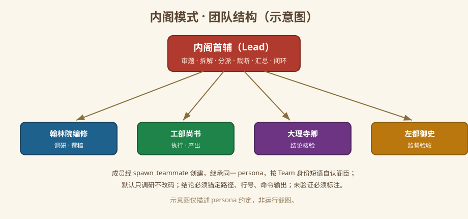
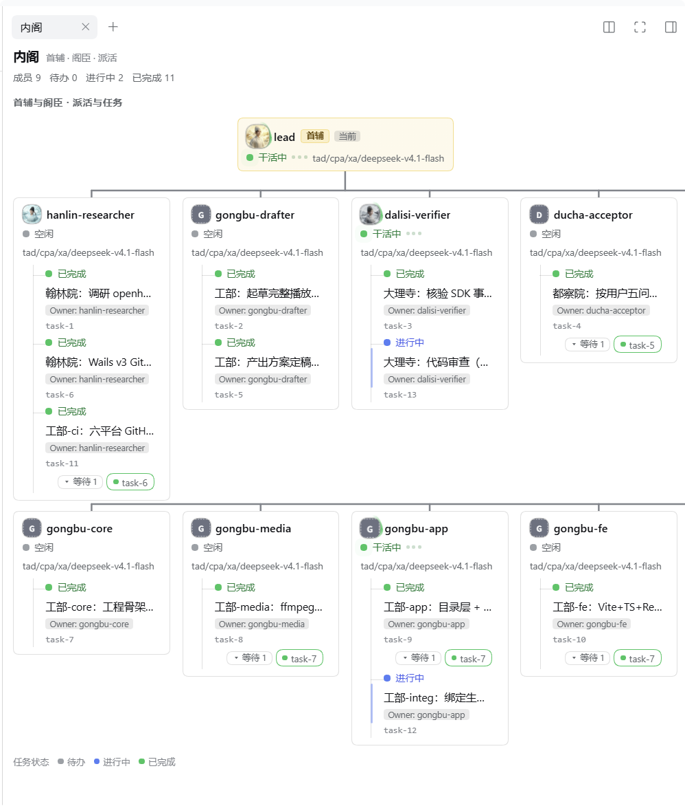
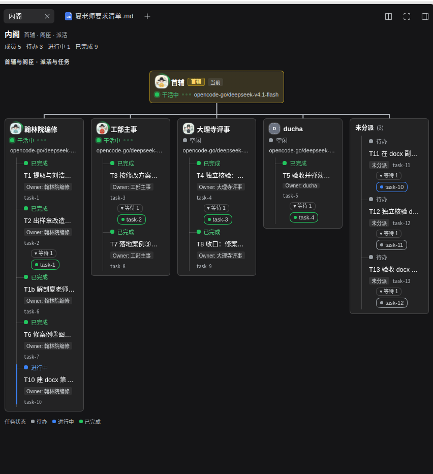

# 内阁模式（Cabinet Mode）· DeepSeek Harness 插件

[English](README.md) | 中文

**安装入口：** [优先从插件市场安装](#从插件市场安装索引源推荐)。

<p align="center">
  
</p>
<p align="center"><sub>图标：明代官员画像，由项目所有者提供（已作 <code>icon.svg</code> 随包发布）。</sub></p>

一个 **DSH bundle**：给 [DeepSeek Harness](https://github.com/deepseek-ai/deepseek-harness) 增加 **内阁模式**（`config.id: cabinet`）。安装本 bundle、重启 DSH，新建会话时在模式选择器里选「内阁模式」即可。

模式设定取自大明科研司·内阁：首辅（Lead）统摄，阁臣（成员）分曹——翰林院编修主调研、工部尚书主执行、大理寺卿主核验、左都御史主验收；默认只调研不改码，不编造数据来源。

本包含 host 半部 `index.js`（成员配置与内阁模式提示词）与浏览器半部 `client.js`（右栏「内阁」面板），面板内嵌五张官职头像与一张无官阶回退头像（128px data URL；源图在 `docs/images/avatars/`，由 `src/build_avatars.py` 缩放生成）；另随包提供可选的 Node.js 回退脚本（`scripts/*.mjs`）。本包使用 `@deepseek-ai/schemastery` 作为配置 schema 运行时依赖，React 等经 DSH 客户端模块表取用，不自带重复依赖或 CDN。

它声明**两行**——`preset-cabinet`（一条 `@deepseek-ai/dsh-agent-preset` 声明）与 `cabinet-ui`（载入本包 JavaScript 的 Loader 行）——并复用 DSH **标准模式**（Standard Mode）出厂的 22 行插件清单，因此工具与标准模式一致；与出厂模式的差异是 persona，并另加右栏「内阁」面板。团队工具（`spawn_teammate`、`team_task_*` 等）由 profile 层的 `@deepseek-ai/dsh-experimental-agent-team-profile` 提供，**本 preset 未内置**。

本包声明 **无 DSH 版本硬限制**：没有 `engines.dsh`、没有 DSH `peerDependencies`、安装时不做版本检查。本机在 DSH **0.2.1-rc.3** 实测；其他提供声明式 preset 机制的 DSH 版本可尝试安装，但**未经验证**（见 [DSH 侧限制与说明](#dsh-侧限制与说明)）。

## 内阁成员配置

通过商店安装 bundle 后，打开 **设置 → 内阁成员**。五个官职组分别支持显示名
（40 字符）、头像和提示词（4000 字符）。内阁卡片与 Owner 标签保留原始成员 ID，
不会改动任务归属或原生成员列表中的运行时名称。

编辑后点击 **保存**；**取消并重新读取** 丢弃草稿并读取最新配置，离开页面也会
丢弃未保存修改。保存按加载时的修订号原子写入五员配置；其他页面已修改时会提示
冲突，须取消重读后再编辑，不会用旧草稿覆盖。配置尚未加载时禁止编辑。
保存的提示词在下一次提示词装配时生效。

每个官职都有 **模型** 下拉，读取官方 `session.modelCatalog`。修改提供方后可点击
**刷新模型目录**；目录中暂时不存在的已存选择仍保留，部分提供方失败不会清空配置。
目录不可用时提供手动 `provider/id` 输入。模型 ID 支持 +、@、空格及额外斜杠，
仅第一个斜杠分隔提供方；格式错误会阻止保存。

仅在 **内阁模式** 中，profile 策略优先于原生会话模型选择：成员显式模型优先；
阁臣留空时使用已配置的首辅模型，首辅未配置时使用当前 **DSH 部署默认模型**。
首辅留空也使用部署默认模型，并非继承另一个会话最后使用的模型。清空会主动恢复
该默认路由，即使历史请求头仍记录上次覆盖模型也不会继续沿用它。

路由在提示词装配时快照，并通过同一 AgentLoop turn signal 关联请求。保存影响
下一次装配，已存活成员同样生效；正在进行的请求保持原快照。实时 cabinet preset
和真实团队角色共同限定范围，名为 lead 的阁臣不会获得首辅策略。换模型时使用
新模型适配器的 reasoning 默认值，同路由保留原生 effort。步骤中途切换模式会
中止该步骤，避免提示词与路由错配；运行期间切出内阁时，将残留插件覆盖恢复到
接管前记录的路由。卸载会中止仍在运行的受管轮次、保留排队输入并移除监听器，但不会改写会话历史。默认模型不可用时明确
报错，不会静默保留旧覆盖。

可上传不超过 2 MB 的 PNG/JPEG/WebP；浏览器居中裁成 96×96 PNG，data URL 不超过
48 KB。保存后头像同时用于内阁面板和原生团队列表。**恢复默认** 将该官职组的
显示名、头像、提示词恢复出厂状态；**重置全部** 重置五员草稿，二者都须再点保存。
清空提示词关闭该官职新增的整段；空 custom 文本也保持为空。默认模式启用首辅的
御下术和四员职责提示。新增提示段只作用于实时绑定 **cabinet** preset 的 Agent，
其他模式不受影响。0.3.1 在内阁静态 persona 中新增分派预算约定：
每个子任务一个交付物、一份写入范围；简单单文件任务最多 30 次工具调用，
多文件合并/解冲突/实机联调最多 100 次，同一失败最多重试 2 次。任务书须写明
预算与停止条件，到限回报「失败/未验证」，不得虚报完成。这只是提示词层面的
约束，没有运行时计数器或强制执行保证。静态 persona 也出现在阁臣的提示词中，靠「仅首辅适用」标题限定语义，并非程序
从阁臣提示词中删除该段。自定义或关闭成员提示词不会删除这条静态策略。
该策略是 0.3.1 的新增行为；0.3.0 曾明确
保持静态 persona 不变，并非解决冲突时意外丢失。

配置隔离边界是 **DSH_HOME/profile** 的 cabinet-ui 命名空间，并非浏览器登录账号。
连接同一 profile 的浏览器共享设置，该 profile 下的内阁会话共用配置；需要隔离时
使用独立 profile/DSH_HOME。坏字段按默认值处理。只安装 preset 的回退方法没有成员
设置页和运行时提示段，请优先使用商店 bundle。


## 团队结构一览



### 运行截图

以下为项目所有者提供的真实运行截图，展示内阁面板的首辅与阁臣层级、谁在干活、任务归属与进度，以及任务依赖标签。上图是 persona 结构示意图；下方两张图则来自实际会话。

#### 浅色主题



浅色会话展示多个成员及其分派任务，绿色运行标记与「进行中／已完成」任务状态分别呈现。

#### 深色主题



深色会话展示相同的任务层级，以及待办、进行中、已完成状态，还包括未分派任务分组和任务依赖关系。

这些截图记录了对应会话中可见的运行状态，不代表跨 DSH 版本兼容性、模式选择器／预设卡片或阁臣 persona 继承行为已经验证。

## 内阁面板与成员形象

右栏新增「内阁」页签（由本包浏览器半部 `client.js` 注册，走第二条 Loader 行 `cabinet-ui`，与 preset 声明互不相干）：

- **派活树**：首辅行在顶，任务按 `ownerName` 缩进挂到对应阁臣名下，`blockedBy` 依赖以标签挂在任务下方——首辅给谁派了什么活、被哪条任务卡住，一眼可见。
- **谁在干活**：成员 running 时整行浅绿高亮、状态点持续脉冲；空闲 / 启动中 / 失败分别用灰 / 琥珀 / 红点区分，首辅行同样参与高亮。
- **任务三色**：待办灰、进行中蓝、已完成绿（面板底部附图例）。
- **成员形象**：每行包含圆形头像、中文称谓与成员原名、状态文字和当前模型。别名共享衙门头像，成员卡片、Owner 标签和不在册分组保留原名以区分身份；截断文字提供完整提示，未匹配名称保留原始身份，使用浅色、无官阶补纹的人物头像，不再显示暗色字母占位。详见[支持的名称与命名约定](docs/images/avatars/aliases.md)，覆盖复合拼音、中文官名、分隔符和数字后缀。

五张原创 Q 版头像采用明代乌纱帽、圆领袍与方形胸补。首辅用酒红袍、鹤补（明确采用“加一品衔大学士”的艺术设定）；翰林院编修为正七品，用鸂鶒补；工部尚书为正二品，用锦鸡补；大理寺卿为正三品，用孔雀补；左都御史为正二品，使用风宪官獬豸补。袍色用于区分角色，不宣称是各品级常服的固定颜色。

详见[衣冠依据、角色设定与生成提示词](docs/images/avatars/README.md)。1254px 正方形源图经 `src/build_avatars.py` 缩放为 128px PNG 并内嵌到 `client.js`；界面实际显示 22–24px，身份辨认仍以角色文字为准。

| 内阁首辅 | 翰林院编修 | 工部尚书 | 大理寺卿 | 左都御史 |
| --- | --- | --- | --- | --- |
|  |  |  |  |  |

面板只读取两条既有数据通道：成员运行状态（`api-session/status`）与会话投影 `agentTeam`（成员名册与任务板），不新增服务、不新增协议。

## 生效说明

- **安装或更新后必须完全退出并重启 DSH**：preset 声明与 client 插件都只在启动时装配，重启前改动不生效。
- 重启后**新建会话**，在模式选择器中选择**内阁模式**（`cabinet`）。
- 打开右栏「内阁」页签：侧栏页签条右上角的「**+**」→ 指南页里的「**内阁**」入口。
- 面板渲染在**浏览器端**（`client.js`）：须重启后在真实会话里实测；浅色与深色面板效果可参见上方[运行截图](#运行截图)。

---

## 从插件市场安装（索引源，推荐）

**用户和 AI 助手都优先通过 DSH 插件市场安装。** 商店会把已发布的 npm bundle 安装到当前 profile，无需克隆仓库、手改配置或寻找 tgz 下载地址。

复制这个 **raw JSON 索引地址**：

```text
https://raw.githubusercontent.com/luodaoyi/dsh-cabinet-mode/market-index/marketplace.json
```

1. 打开「**插件 → 实验性插件**」，必要时点击「**更多**」，启用「**自定义插件市场**」。
2. 返回「**插件 → 发现**」，打开「**索引源**」，粘贴上面的 raw 地址，点击「**添加**」。
3. 等待出现「**内阁模式 / Cabinet Mode**」，点击「**安装**」。确认弹窗中的包名为 `dsh-cabinet-mode@<版本>`，注册表为 `https://registry.npmjs.org/`，再确认安装。
4. 检查界面显示「**已安装**」及版本号。点击「**立即启用**」，或在「**已安装**」页打开插件开关；安装完成不等于已经启用，单纯重启不会打开关闭的插件。然后**完全退出并重启 DSH**，新建会话，在模式选择器中选「**内阁模式**」（`cabinet`）；需要时通过右侧栏「**+**」打开内阁页签。

**不要填写 GitHub 的 `blob` 或 `tree` 网页地址。** DSH 不会把网页自动转换成索引；我们已用 blob 地址复现 `$.format must be 1`。遇到该错误，移除错误源，重新添加上述 raw 地址。Respire 等其他商店也适用同一规则。

**验证范围：** 2026-11-05 已在 Windows、DSH 0.2.1-rc.5 的隔离 web profile 中，通过真实客户端添加 raw 索引并安装 0.2.0；随后验证了从旧版卸载、刷新索引并安装 0.2.2，以及安装后需单独启用的流程。其他 DSH 版本和 Linux/macOS 的商店界面流程尚未验证；索引格式另由官方 rc.5 解析器回归测试。真实团队任务交互属于另一项验证。

## 让 AI 帮你安装（复制下面这段提示词）

```text
请帮我安装 DeepSeek Harness 的「内阁模式」bundle，优先使用插件市场索引：
https://raw.githubusercontent.com/luodaoyi/dsh-cabinet-mode/market-index/marketplace.json

1. 确认我的 DSH 版本和目标 profile。通过已有界面启用「自定义插件市场」，进入「插件 → 发现 → 索引源」。
2. 添加上面的 raw JSON 地址。不要使用 GitHub blob/tree 网页，不要修改索引，也不要编造添加商店源的 CLI 命令。
3. 从该源安装「内阁模式」，确认弹窗为 dsh-cabinet-mode@<版本>、注册表为 https://registry.npmjs.org/，然后核实「已安装」结果和版本号。点击「立即启用」或在「已安装」页打开插件开关，确认启用状态。
4. 如果你无法操作界面，请给我简短的界面步骤；只有市场不可用或我选择备用方法时，才使用 Release tgz 或本地目录，并先解释具体原因。
5. 不要再向 profile 追加 cordis.patch.yml，避免重复 preset。保留我的已有 profile 和其他插件。
6. 提醒我完全退出并重启 DSH，新建会话并选择「内阁模式」（preset id cabinet）。未核实安装版本不要声称成功，未测试的团队交互不要声称已验证。

失败时给出原始错误。遇到 $.format must be 1，先把网页源换成 raw JSON 地址；不要反复重装或悄悄换安装方法。
```

## 备用：Release 包或本地目录安装

仅在商店不可用或本地开发时使用。先完全退出桌面 DSH，释放 profile 锁，再执行：

```sh
dsh plugin --profile desktop add https://github.com/luodaoyi/dsh-cabinet-mode/releases/download/v0.4.1/dsh-cabinet-mode-0.4.1.tgz
dsh plugin --profile desktop list
```

核实安装版本，重启 DSH 后新建会话并选择内阁模式。本地开发可把 URL 换成仓库绝对路径；CLI 不可用时，在「插件 → 添加插件」选择 tgz URL 或本地目录。确认目标 profile：`desktop` 是桌面应用 profile。上述方法均不可与手工 preset patch 叠加。可选安装脚本仅提供 persona preset 回退，不提供内阁界面。

## 升级

若通过插件市场安装：刷新市场，先在**已安装**页卸载旧版本，再从**插件市场**安装新版本，然后重启——没有 tgz URL 要换，也没有一键更新。否则用同一条安装命令换新版本 URL（或在插件页选新 `.tgz`），然后完全退出并重启 DeepSeek Harness：

```sh
dsh plugin --profile desktop add https://github.com/luodaoyi/dsh-cabinet-mode/releases/download/v0.4.1/dsh-cabinet-mode-0.4.1.tgz
```

`dsh plugin --profile desktop list` 应显示新版本。升级已在 Windows 实测：
v0.1.0 → v0.1.1 走插件 CLI（DSH 0.2.1-rc.3）；v0.1.1 → v0.1.2 与
v0.1.2 → v0.1.3 走内嵌 pnpm（DSH 0.2.1-rc.5）。

---

## 你会得到什么

| | |
|---|---|
| 模式 | 内阁模式（**Cabinet Mode**），preset id `cabinet`，order 5 |
| 身份 | 同一段 persona 由首辅与所有阁臣共享：首辅（Lead）审题、拟旨拆解、分派、裁断、汇总、闭环；阁臣（翰林院编修/工部尚书/大理寺卿/左都御史）按衙门办事，禁止自称首辅。 |
| 默认姿态 | 默认只调研不改码；每条结论锚定路径、行号、命令输出或原文；不确定处标「未验证」；不编造数据来源。 |
| 工具 | 与 0.2.1-rc.3 实测参照的标准模式相同的 22 行插件（shell、文件系统、后台任务、定时、技能、目标、计划模式、压缩、委派/工作流、ask-user、todo、web、present）。 |
| 平台 | 跨平台：`tool-bash` 在 Linux/macOS 启用、`tool-pwsh` 在 Windows 启用，与标准模式一致；无绝对路径、无 shell 专用安装步骤、无构建步骤。 |
| 团队工具 | 九个 Agent Team 工具来自 `@deepseek-ai/dsh-experimental-agent-team-profile` 这个 profile bundle，不由本 preset 提供。若你的 DSH profile 未启用该 bundle，则没有 teammate 工具，但 persona 规则仍生效。 |

## 前置条件

- **带声明式 agent preset 的 DeepSeek Harness**。preset 声明以 0.2.1-rc.3 为组合
  参照；**真实安装/升级已在 Windows 桌面端用 DSH 0.2.1-rc.3 与 0.2.1-rc.5 实测**
  （本地目录、Release 资产 URL、内嵌 pnpm 三种途径；2026-10-29 与 2026-10-31）。
  本包**不声明 DSH 版本依赖、不做 DSH 版本硬限制**（没有 `engines.dsh`、没有 DSH
  `peerDependencies`）；其他带声明式 preset 机制的 DSH 版本可以尝试，但**未验证**。
  仍未实测：重启后的 UI（模式选择器 / 预设卡片 / 图标显示）与非 Windows 宿主。
- 其他 DSH 版本内置的标准模式插件集合可能不同。若声明加载失败，请按你所用版本的
  `presets/standard.patch.yml` 调整插件行（保留 `persona` 行及其配置，增删对应工具行；
  详见 [DSH 侧限制与说明](#dsh-侧限制与说明)）。
- Node.js **>= 20**，仅回退脚本（`scripts/*.mjs`）需要；推荐的插件安装方式不直接依赖 Node。
- 可选：启用 **Agent Teams**（智能体团队）获得完整首辅/阁臣流程。

## 安装方式（三平台矩阵）

| 方式 | Windows | Linux | macOS | 说明 |
|---|---|---|---|---|
| **插件市场**（索引源）：见 [从插件市场安装](#从插件市场安装索引源推荐) | ✅ **Windows rc.5 web 客户端安装已实测**（隔离 profile，2026-11-05） | ❌ **未实测** | ❌ **未实测** | 通过 DSH 插件市场安装同一个 npm bundle；npm 发布与 `market-index` 分支均已存在。 |
| **A. DSH 插件管理器**（备用）：插件页「添加插件 → 本地目录/包」，或 `dsh plugin --profile <profile> add <绝对路径 / .tgz / release URL>` | ✅ 2026-10-29 本机实测：本地目录安装与 **GitHub Release 资产 URL 安装**均成功；`dsh plugin --profile desktop list` = 3 packages；合成校验通过 | ⚙️ 代码级推断，**未在本机实测** | ⚙️ 代码级推断，**未在本机实测** | 纯 YAML bundle：无构建、无依赖、无 OS 专用代码。见 [docs/cross-platform.md](docs/cross-platform.md)。 |
| **B. 回退 node 脚本**（无插件管理器时）：`node scripts/install.mjs --profile <profile>` 演练后 `--apply`，写入 profile 的 `cordis.patch.yml` | ✅ 脚本已在 Windows 实测（演练 + 临时副本） | ⚙️ 代码级推断，**未实测** | ⚙️ 代码级推断，**未实测** | 三平台同一路径：`<DSH_HOME>/profiles/<profile>/cordis.patch.yml`。 |

**方式 A 与方式 B 二选一，不可叠加。** 两种方式都会声明 `config.id: cabinet`；同时装会让 preset id 重复，声明加载失败。切换前先卸载旧方式。插件市场安装的是与方式 A 相同的 bundle，同样受这条互斥约束。

### A. 备用：直接安装 DSH bundle

1. 安装到你在用的 profile：
   - **插件页**：设置 → 插件 → 添加插件 → 本地目录/包，选择本仓库（或其 `.tgz`）。
   - **命令行**：`dsh plugin --profile desktop add <仓库绝对路径、.tgz 或 release URL>`
2. 确认：`dsh plugin --profile desktop list` 出现 `dsh-cabinet-mode`。
3. 完全退出并重启 DeepSeek Harness。
4. 新建任务，在模式选择器中选择 **内阁模式**。

本地目录安装与 GitHub Release 资产 URL 安装均已于 2026-10-29 在 Windows + DSH 0.2.1-rc.3 实测
（URL 安装约 2.4 s，`dsh plugin --profile desktop list` 报 3 packages）。

### B. 回退：写入 profile patch 层（无插件管理器时）

此方式只安装 persona 预设。内阁面板与成员头像需要使用方式 A，将运行时包安装到 profile。

需要 Node.js >= 20。脚本跨平台，默认演练。

```sh
node scripts/install.mjs --profile desktop          # 演练：只打印计划，不写文件
node scripts/install.mjs --profile desktop --apply  # 备份 → 写入 → 写后自检
node scripts/verify.mjs                             # 仓库校验 + dsh 合成校验
# 完全退出并重启 DeepSeek Harness
```

脚本写入 `<DSH_HOME>/profiles/<profile>/cordis.patch.yml`（Windows 默认 `%USERPROFILE%\.dsh`，Linux/macOS 为 `~/.dsh`）。它会：拒绝在已装 bundle 的 profile 上重复安装；拒绝目标已含 `preset-cabinet`；写前备份（精确到秒 + 随机短后缀，避免覆盖旧备份）并校验 SHA-256；用 `BEGIN/END` 标记包裹 insert；目标为空/`[]`/仅注释时整文件替换（此时追加会产出非法 YAML）；写后结构自检失败自动从备份还原。

## 启用与验证

- **必须重启**：preset 声明在启动时加载，变更只影响之后创建的会话。
- 新建任务 → 模式选择器 → **内阁模式**（`cabinet`）。会话一旦产出内容，模式在会话生命周期内固定。
- 设置 → Agent 预设中应出现「内阁模式」卡片，配置查看为只读。
- 仓库校验：`node scripts/verify.mjs`，检查 package 字段、无 DSH 版本门禁、preset 声明、22 行插件清单、双身份 persona、跨平台 guard、README/docs 一致性，并在本机有 `dsh` 时运行
  `dsh --profile web --patch ./cordis.patch.yml --dump-config`，断言 exit 0、`preset-cabinet` 恰 1 条、出厂 4 个 preset 未减。DSH 版本只做信息性打印，不因版本不同而失败。

## DSH 侧限制与说明

本模式是 DSH 的 preset；DSH 自身的限制仍在。以下事实在本机 DSH 0.2.1-rc.3 已核，描述的是 DSH 行为，不是本 bundle 添加的限制。

- **无 DSH 版本硬限制。** 本包没有 `engines.dsh`、没有 DSH `peerDependencies`（0.1.1 起的既定产品决定，见 CHANGELOG），安装时也不做版本检查；已在 DSH **0.2.1-rc.3**（组合参照）与 **0.2.1-rc.5**（真实安装/升级，Windows 桌面端）实测，其他版本与多版本组合仍未实测。22 行插件清单取自 0.2.1-rc.3 出厂标准模式；若你的 DSH 版本内置插件集合不同（多/少行）导致声明无法加载，请按你版本的 `presets/standard.patch.yml` 调整 `cordis.patch.yml`：保留 `persona` 行及其配置，增删对应插件行，使清单与该版本一致。
- **Agent Team 上限**来自 profile 中的 `@deepseek-ai/dsh-experimental-agent-team-profile` bundle 配置（已核默认值，桌面 profile 设置）：`maxMembers: 8`、`maxTasks: 256`、`maxMessageBytes: 65536`、`disposalTimeoutMs: 5000`。deployment 默认 `maxMembers` 为 16，本机桌面 profile 设为 8。`maxMembers` 含失败的 teammate；单条 Team 消息 ≤ 64 KiB。
- **Team 工具依赖该 profile bundle。** 九个 Agent Team 工具（`spawn_teammate`、`send_message`、`list_agents`、`interrupt_agent`、`wait_agent`、`team_task_*` 等）仅在 profile 含 `@deepseek-ai/dsh-experimental-agent-team-profile` 时可用；否则内阁模式没有团队工具，persona 规则仍生效但无法实现首辅/阁臣分工。
- **权限/沙箱由 DSH 决定。** 沙箱与审批行为由 DSH permission preset 决定（本机 desktop profile 用户层为 `danger-full-access`）；本模式**不添加**任何沙箱限制，也不放宽 DSH 策略。
- **preset 是受信任配置。** 其插件可执行宿主代码；只安装来源可信的 preset。
- **无 OS 限制、无插件白名单、无需 npm 账号。** 纯平台无关 YAML，通过 GitHub Release tgz 与公开 npm 包分发；两种方式安装都不需要 npm 账号，也不需要插件白名单条目。
- **重启、会话锁定、Web 只读。** 安装/卸载需重启 DSH；会话一旦产出内容，模式在会话生命周期内锁定；Web 端只能选择模式并只读查看配置，不能编辑。

## 回退 / 卸载

| 安装方式 | 卸载命令 | 之后 |
|---|---|---|
| 方式 A（bundle） | `dsh plugin --profile desktop remove dsh-cabinet-mode` | 完全重启 DSH |
| 方式 B（node 脚本） | `node scripts/uninstall.mjs --profile desktop --apply` | 完全重启 DSH |

回退卸载脚本只删除自己写入的 `BEGIN/END` 标记块；遇到不是它写入的 `preset-cabinet`（bundle 或手工安装）会拒绝处理，请改用插件页卸载。两个脚本默认演练，加 `--apply` 才写。

## 发布（维护者）

推送版本 tag 会触发 `.github/workflows/release.yml`：校验工作树 → 打包 tarball → 用 **Trusted Publishing（OIDC）** 发布到 npm（不使用长期 npm token）→ 创建 GitHub Release → 刷新插件市场读取的 `market-index` 分支。

```sh
# package.json 版本与 CHANGELOG 对应章节都必须是 0.2.0
git tag v0.2.0
git push origin v0.2.0
```

npmjs.com 侧的一次性配置（维护者在网页上完成，无法从本仓库完成）。为该包添加 GitHub Actions trusted publisher：

- Organization or user：`luodaoyi`
- Repository：`dsh-cabinet-mode`
- Workflow filename：`release.yml`（只填文件名，含扩展名；文件必须保持在 `.github/workflows/release.yml`，且发布步骤留在该文件内）
- Environment name：留空，除非以后给发布 job 加 GitHub environment
- **Allowed actions：必须选上 `npm publish`。** 2026-09-03 之后创建的 trusted publisher 默认只有 `npm stage publish`；不显式允许时普通 `npm publish` 会被拒绝。

新建的 trusted publisher 配置必须在 **2 天内**完成首次成功发布，否则失效，只能删除重建。`package.json` 的 `repository.url` 必须与 GitHub 仓库精确匹配——本仓库已满足（`git+https://github.com/luodaoyi/dsh-cabinet-mode.git`）。

**首个版本需要一次性引导。** npm 不允许给尚不存在的包配置 trusted publisher（`npm trust` 要求 Package must exist，npm/cli#8544 仍未关闭）。`dsh-cabinet-mode` 已于 2026-11-03 用 `npm stage publish`（npm ≥ 11.15.0）引导：它公开了一个占位版本 `0.0.0-stage`，真实版本留在暂存区等待审批。占位版是预发布版，插件市场索引不会列出它。之后的版本不再需要引导：推 tag 即由工作流用 OIDC 发布。

以上 npm 侧事实来源为 npm 官方文档《Trusted publishing for npm packages》（https://docs.npmjs.com/trusted-publishers）；npmjs.com 当前界面布局本仓库**未验证**。Trusted Publishing 要求 npm CLI ≥ 11.5.1、Node ≥ 22.14.0——工作流使用 Node 24。`npm whoami` 不能用来检查 trusted publishing 权限（npm 文档明确说明），因此工作流不把它当前置检查。

若 npm 发布成功但索引 job 失败，手动运行 **Market index** 工作流刷新分支。

分支发布脚本是 `scripts/publish-market-index.sh`（`npm run market:publish` 也调用它）；它需要 `bash`，Git for Windows 自带。该脚本会切孤儿分支并改写工作树，**只能在无未提交改动的一次性 clone 里运行**——它遇到被修改或已暂存的已跟踪文件会拒绝执行，但未跟踪文件不受保护。

## 未实测项（不得冒充已验证）

- **多版本兼容**：DSH 0.2.1-rc.3（组合校验、插件 CLI 安装）与 0.2.1-rc.5（真实
  安装 + 升级，Windows 桌面端，2026-10-31）已实测；其他 DSH 版本与升级路径未验证。
- **重启后的 UI 与图标显示**——模式选择器、Agent 预设卡片、bundle 图标在任何
  机器上都尚未重启验证。
- **Linux / macOS** 上的真实 bundle 安装与重启后模式选择器（本机仅 Windows 实测，
  Linux/macOS 为代码级推断）。
- teammate 实测行为：被 spawn 的成员是否继承同一 persona 并真的按阁臣身份行事、不称首辅。
- DSH 升级后已装 bundle 或回退 patch 是否保留。
- `config.id` 语法校验规则（本 id 为 `cabinet`，仅小写字母）。
- preset 声明的 HMR 热生效、私有源/代理下的 tgz 安装。
- **市场更新与其他客户端。** 已在 Windows rc.5 web 客户端验证添加 raw 索引、安装 0.2.0，以及卸载后从市场安装 0.2.2；其他 DSH 版本与平台尚未验证。

## 已知限制

- preset **不是安全沙箱**：声明属于受信任配置，可执行宿主代码；安装前请审阅 bundle。
- 用户覆盖本 preset 时会替换整份插件清单，不会合并上游后续更新。
- 其他 DSH 版本内置的标准模式插件集合可能不同；这里的 22 行是 0.2.1-rc.3 参照，可能需要按版本适配（见 [DSH 侧限制与说明](#dsh-侧限制与说明)）。
- persona 由首辅与所有阁臣共享，只能依靠 Agent Team runtime context 的精确短语判身份
  （`You are the Team Lead named "lead".`、`You are teammate "<name>".`、`Your Team Lead is named "lead".`）；
  阁臣禁止自称首辅。
- persona 不得含 `{{cwd}}` 等未注册提示词变量；0.2.1-rc.3 会在首次模型请求前因组装失败报错。
- 团队流程依赖 Agent Teams profile bundle 已启用。

## 跨平台说明

详见 [docs/cross-platform.md](docs/cross-platform.md)：插件安装链、`!!js process.platform` guard、回退 patch 路径的代码级分析，以及「Windows 已实测 / Linux、macOS 为推断」的分界。分节：

- [结论矩阵](docs/cross-platform.md#结论矩阵)（平台 × 13 项，含实测程度列）
- [逐项论证](docs/cross-platform.md#逐项论证)
- [未在本机实测清单](docs/cross-platform.md#未在本机实测清单)
- [依据索引](docs/cross-platform.md#依据索引)

## 许可证

[MIT](LICENSE)
